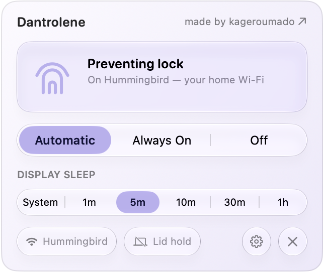

# Dantrolene

Dantrolene keeps your Mac unlocked on a chosen Wi-Fi network while still dimming the display after inactivity. Leaving that network restores normal locking. The GitHub edition controls the real backlight; the App Store edition uses black overlays.

## Highlights

- Keep the Mac unlocked on a chosen Wi-Fi network and restore normal locking when leaving it.
- Dim the display during inactivity while the trusted-network hold remains active.
- Use real display and keyboard backlight control in the GitHub edition.

Full feature list

- Home-network, Always On, and Off modes.
- Choose a network through the menu-bar house → **Choose… → Set as Home**.
- Launch at login and inactivity dimming.
- GitHub edition: real backlight control and closed-lid holds through Adrafinil.
- App Store edition: sandboxed, with black overlay windows for display dimming; the panel stays lit.

## Notes

- macOS 26+ · Location Services permission to read the Wi-Fi name.
- Homebrew: `brew install --cask kageroumado/tap/dantrolene`.
- A copied Wi-Fi name can trigger the hold; this setting does not authenticate the network. [Privacy](PRIVACY.md) · [Implementation](REFERENCE.md).
